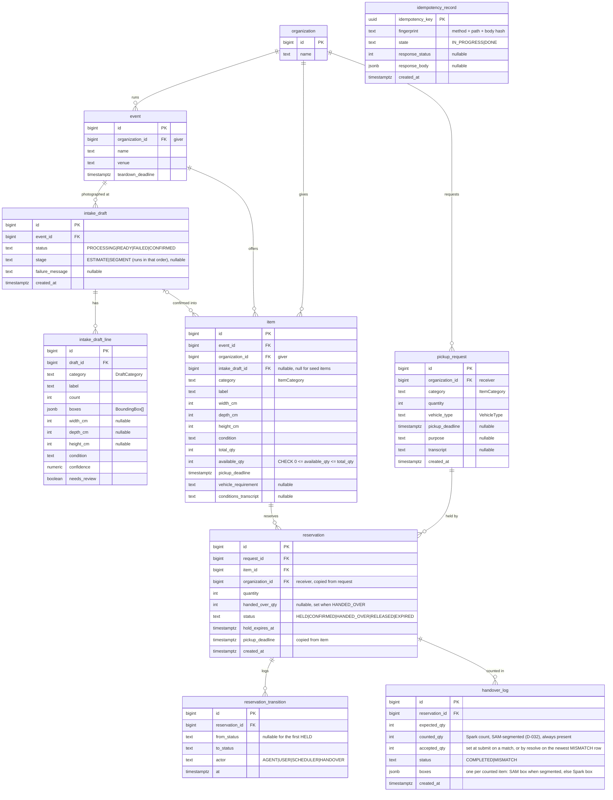

# ERD — AfterBooth data model

The database shape of record. It is derived from `contract/openapi.yaml` and `docs/SPEC.md`; if they disagree, fix this file in the same PR as the contract change. Entities in code follow `docs/CONVENTIONS.md` (behavior on entities, other aggregates by ID).

## Rules the schema must keep

| Rule | Where it is enforced |
|---|---|
| `available_qty` never goes below 0 or above `total_qty` | `CHECK` constraint + conditional `UPDATE ... WHERE available_qty >= :q AND :q > 0` |
| `available_qty = total_qty − Σ(HELD, CONFIRMED quantity) − Σ(HANDED_OVER handed_over_qty)` | Every status change and its quantity effect happen in one transaction |
| A reservation's status changes only along the table in `ReservationStatus` (contract) | `Reservation` entity methods + a conditional `UPDATE ... WHERE status = :expected` so confirm and expiry cannot both win |
| Each request's active quantity ≤ `pickup_request.quantity` | `SELECT ... FROM pickup_request WHERE id = :id FOR UPDATE` first, then sum active reservations and insert, all in one transaction. Both `holdItem` and the agent's `holdQuantity` take this lock, so concurrent holds on different items for one request are serialized |
| One allocation run per request while it has an active reservation | Checked inside the same `pickup_request` row lock (REQUEST_ALREADY_HELD), so a concurrent second run for the same request gets 409 |
| A handover completes only after a photo recount whose Spark and SAM 3.1 calls both completed (a failed call writes no row) | `resolveHandover` requires the newest `handover_log` row for the reservation to be MISMATCH; `counted_qty` is NOT NULL |
| Same Idempotency-Key never runs twice | `idempotency_record` row inserted first (`IN_PROGRESS`), response stored on `DONE` |

## Notes

- **Reuse stats are a query, not a table.** `getReuseStats` sums `reservation.handed_over_qty` for HANDED_OVER reservations, grouped by item category and event. SPEC's "ReuseStat" is this read model.
- **Allocation runs are not stored.** A same-key retry replays the response kept in `idempotency_record`; holds are re-read from `reservation`.
- **Labels are not stored for lookups.** `item.label` is written from the category table in the contract (`ItemCategory`) at confirm time, and stats labels use the same table.
- **Times are `timestamptz`.** The API returns them with the +09:00 offset (`docs/DECISIONS.md` D-019).
- **Enums are `text` columns** mapped with `@Enumerated(EnumType.STRING)`, so values match the contract strings exactly.
- **Seed data** (organizations, one event, demo items) lives in a Flyway migration so every environment, including Testcontainers, starts the same.

## Migrations

- Version with a timestamp so parallel branches never collide: `V202610311200__create_core_tables.sql` (`V` + `yyyyMMddHHmm`).
- #3 creates every table above in one migration. Later changes add new migrations; merged migrations are never edited.
